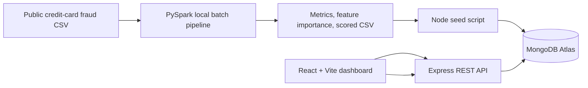

# FraudLens

FraudLens is a 7th-semester Big Data Analytics project that demonstrates an offline PySpark fraud-detection workflow and a JavaScript web application for reviewing its results. Spark performs batch processing and model training; Express provides authenticated APIs; MongoDB stores the imported output; React presents the results.

## Architecture

Spark runs offline in local mode because it is a distributed data-processing engine, not a JavaScript web-server library. Keeping it outside HTTP requests prevents long-running training jobs from blocking API traffic. MongoDB is the shared storage boundary between the batch pipeline and the web app.

## Environment variables

Keep local values in ignored `.env` files and production values in the hosting provider's secret settings. The checked-in examples contain placeholders only.

| Folder | Variables | Purpose |
| --- | --- | --- |
| `server/` | `MONGODB_URI` | MongoDB Atlas connection URI, including the database name. |
| `server/` | `JWT_SECRET` | Random server-only HMAC secret, at least 32 characters; never expose it to the client. |
| `server/` | `JWT_EXPIRES_IN` | JWT lifetime accepted by both token signing and verification (example `8h`). |
| `server/` | `CLIENT_ORIGIN` | Exact browser origin allowed by CORS, for example `http://localhost:5173`. |
| `server/` | `PORT`, `NODE_ENV` | HTTP port (default `4000`) and runtime mode (`development` or `production`). |
| `server/` | `ADMIN_NAME`, `ADMIN_EMAIL`, `ADMIN_PASSWORD`, `ANALYST_NAME`, `ANALYST_EMAIL`, `ANALYST_PASSWORD` | Initial accounts created by the seed command. Set unique, strong passwords before seeding. |
| `client/` | `VITE_API_URL` | Public API base URL, including `/api`; it is embedded in the browser build and must not contain secrets. |
| `pipeline/` | None | Pipeline paths are CLI flags (`--input`, `--output`). On Windows, configure `JAVA_HOME` for Java 17. The pipeline writes CSV output from Python to avoid Hadoop's Windows `winutils.exe` requirement. |

Copy `server/.env.example` to `server/.env` and `client/.env.example` to `client/.env`. The pipeline does not need a `.env` file or MongoDB credentials; pipeline output is imported separately by the server seed command.

## Scope and the 5 Vs

- **Volume:** Spark reads the CSV in distributed DataFrame form and processes partitions locally. Laptop local mode is suitable for a demonstration, not a production-scale cluster.
- **Velocity:** The current scope is batch scoring, not real-time streaming.
- **Variety:** The chosen dataset is a tabular CSV with numeric transaction features and a binary `Class` label.
- **Veracity:** The pipeline checks required fields, casts numeric values, drops invalid rows, and reports input/output counts from actual runs.
- **Value:** Precision, recall, F1, ROC-AUC, confusion matrix, feature importance, and scored records support fraud review.

## Features

**Must-have:** offline data validation and cleaning, weighted Logistic Regression and Random Forest, precision/recall/F1/ROC-AUC/confusion matrix, score export, MongoDB import, JWT login with admin/analyst roles, filtered transactions, summary, model comparison, and investigation status workflow.

**Nice-to-have:** production deployment, live transaction scoring, streaming, explainability with SHAP, and external identity provider. These are not implemented by this laptop demo.

## Dataset

Use the public European cardholder transactions dataset commonly distributed as `creditcard.csv` (features `Time`, `V1`–`V28`, `Amount`, and label `Class`). Obtain it from its public dataset publisher (commonly mirrored on Kaggle as “Credit Card Fraud Detection”). Review the download source's current terms and attribution requirements before submission. The dataset is not included because it is large and redistribution terms may apply. Place the CSV at `pipeline/data/creditcard.csv`. Do not claim any dataset-based metrics until you have run the pipeline on that file.

## Repository map

- `pipeline/`: PySpark local batch pipeline and its configuration.
- `server/`: Express API, Mongoose models, authentication, and seed command.
- `client/`: React/Vite dashboard.
- `docs/`: architecture, deployment, project report, and viva material.

## Windows setup

Prerequisites: Git, Node.js LTS, Python 3.11, Java 17, and MongoDB Atlas. Configure `JAVA_HOME` to the JDK 17 installation and add its `bin` directory to `PATH`. Restart the terminal after changing environment variables.

1. Copy `server/.env.example` to `server/.env` and set `MONGODB_URI`, a long random `JWT_SECRET`, and the admin/analyst email and password values. Never commit `.env`.
2. Install server packages: `cd server; npm install`.
3. Install client packages: `cd ..\client; npm install`.
4. Install pipeline dependencies: `cd ..\pipeline; py -3.11 -m venv .venv; .\.venv\Scripts\Activate.ps1; python -m pip install -r requirements.txt`. To run the PySpark helper tests, install `requirements-dev.txt` instead.
5. Place the permitted dataset at `pipeline/data/creditcard.csv`. In PowerShell, run `cd pipeline; $env:JAVA_HOME='C:\Program Files\Eclipse Adoptium\jdk-17.0.20.101-hotspot'; $env:PATH="$env:JAVA_HOME\bin;$env:PATH"; .\.venv\Scripts\Activate.ps1; python run_pipeline.py --input .\data\creditcard.csv --output .\output`. Adjust `JAVA_HOME` if Java 17 is installed elsewhere.
6. Import the generated metrics and scored transactions: `cd ..\server; npm run seed -- --input ..\pipeline\output --skip-users`. This imports pipeline artifacts without requiring seed-account passwords. Omit `--skip-users` only if you configured the admin and analyst seed credentials in `server/.env`.
7. Start the API in one terminal: `cd server; npm run dev`.
8. In another terminal, run `cd client; npm run dev`; open the Vite URL (normally `http://localhost:5173`) and use **Sign up** to create an analyst account.

For a local MongoDB instance, set `MONGODB_URI=mongodb://127.0.0.1:27017/fraudlens` in `server/.env`; for Atlas, use your own database URI and allow your current IP in Atlas network access. Keep the URI private. Initial passwords should be changed before any shared deployment.

See [server/README.md](server/README.md) for API endpoints and request examples, [server/api.http](server/api.http) for smoke requests, [docs/database-design.md](docs/database-design.md), [docs/security.md](docs/security.md), [docs/deployment.md](docs/deployment.md), [docs/PROJECT_REPORT.md](docs/PROJECT_REPORT.md), and [docs/VIVA.md](docs/VIVA.md).

## Verification

Run `cd server; npm test`, `cd client; npm test`, and `cd client; npm run build`. Run pipeline checks with `cd pipeline; .\.venv\Scripts\python.exe -m pytest`. The full PySpark pipeline generates the metrics and scored CSVs locally under `pipeline/output`; those files are not checked into the repository and results depend on the dataset and runtime environment.

## Known limitations

- Local Spark mode uses one laptop and may be memory- or time-limited on the full dataset.
- Initial risk threshold is 0.5; threshold selection and calibration are not optimized for production.
- Scores are generated for the held-out test split, not the entire source dataset. A single train/test split provides a teaching comparison, not a guarantee of generalization.
- Self-service registration creates analyst accounts only; an admin account must be created through the seed configuration.
- The browser stores the short-lived demo JWT in local storage; production deployments should consider an HttpOnly cookie/session design and add CSRF defenses if cookies are used.
- Atlas connectivity and deployment require user-owned credentials and services and are not verified by this source code alone.
